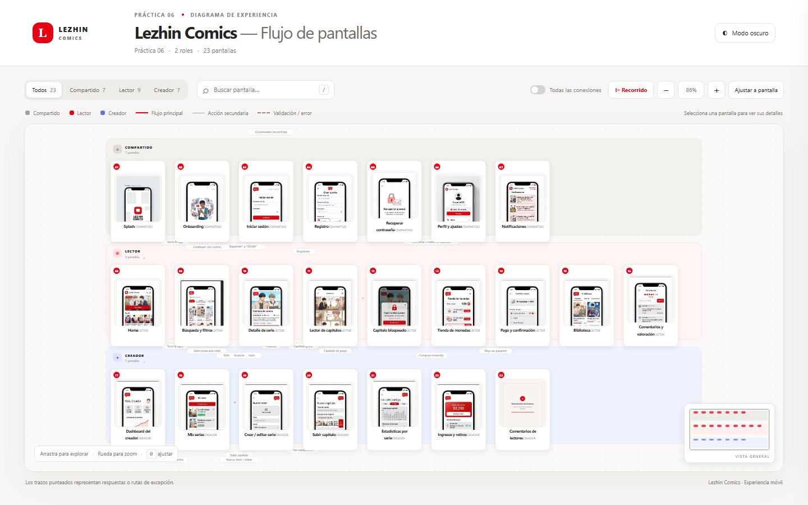

# Práctica 06 · Diagrama de secuencia de pantallas

## Enunciado

A partir de la plataforma elegida para el modelo CANVAS, elaborar un diagrama de secuencia de pantallas orientado a una aplicación móvil. Debe considerar al menos dos roles y un mínimo de 15 pantallas compartidas y específicas, y servir como insumo para el agente Archify.

La plataforma elegida es **Lezhin Comics**, servicio de webcomics y manhwa con capítulos que pueden desbloquearse mediante monedas. El diagrama describe una propuesta académica de experiencia móvil; las conexiones expresan acciones del usuario y no afirman que exista una aplicación funcional con estos flujos exactos.

## Roles y pantallas

El recorrido incluye **23 pantallas**: 7 compartidas, 9 para el rol **Lector** y 7 para **Creador**. El registro permite elegir el rol.

- **Compartidas (1–7):** Splash, Onboarding, Iniciar sesión, Registro, Recuperar contraseña, Perfil y ajustes, Notificaciones.
- **Lector (8–16):** Home, Búsqueda y filtros, Detalle de serie, Lector de capítulos, Capítulo bloqueado, Tienda de monedas, Pago y confirmación, Biblioteca, Comentarios y valoración.
- **Creador (17–23):** Dashboard del creador, Mis series, Crear / editar serie, Subir capítulo, Estadísticas por serie, Ingresos y retiros, Comentarios de lectores.

El mapa diferencia el flujo principal de las acciones secundarias y de las ramificaciones de error o acceso. Se puede filtrar por rol, buscar pantallas, activar todas las conexiones, seleccionar nodos, recorrer los flujos, acercar el lienzo y cambiar el tema.

## Diagrama publicado

[Abrir el flujo interactivo de Lezhin Comics](https://koudionicio.github.io/Practicas_INTEGRADORA_230237/)



## Abrir en local

Desde la raíz del repositorio, inicia un servidor estático para la carpeta publicada:

```bash
python -m http.server 8000 --directory docs
```

Abre [http://localhost:8000/](http://localhost:8000/).

El sitio usa HTML, CSS y JavaScript sin instalación ni dependencias externas.
